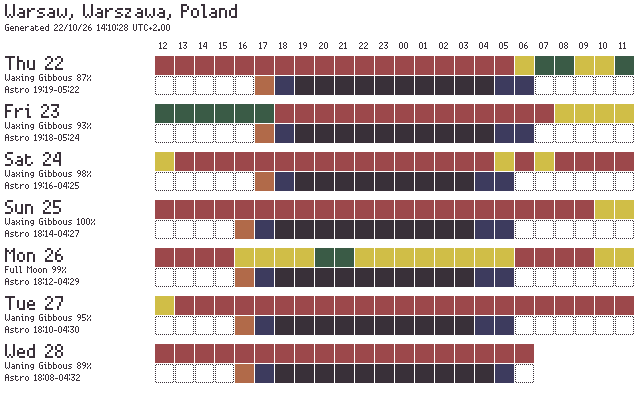

# clear-outside-inky-frame

Astronomy forecast from [Clear Outside](https://clearoutside.com/) for the Pimoroni Inky Frame 4.0.



## Data source

`src/clearoutside.py` streams and parses the HTML page `/forecast/<lat>/<lon>` line by line (≈215 KB, never held in RAM).

```python
import clearoutside
data = clearoutside.fetch("12.34", "56.78")
```

Per day it returns: hours, hourly rating (0 good / 1 ok / 2 bad), moon phase / illumination / rise / set, sunrise / sunset, civil / nautical / astro dark, and the selected hourly rows (clouds, precipitation, wind, temperature, humidity, ...; see `ROWS` / `DEFAULT_KEEP`).

## Running on the Inky Frame

Copy `src/main.py`, `src/clearoutside.py`, `src/logconfig.py`, `src/logging.py` (vendored from micropython-lib, because the firmware's built-in `logging` lacks `Formatter` and `FileHandler`), `src/board.py` and a `secrets.py` to the root of the board:

```python
WIFI_SSID = "Your WiFi SSID"
WIFI_PASSWORD = "Your WiFi password"
```

`main.py` holds the configuration (`UPDATE_INTERVAL` and `RETRY_INTERVAL` in minutes, max 255) and the update cycle. The frame buffer and the HTTPS download don't fit in RAM together, so each boot does one of two things: download the forecast and save it to `forecast.json` (`clearoutside.update()`), then restart; or, when `forecast.json` exists, allocate the frame buffer and draw it (`clearoutside.show()`), delete the file and sleep. The drawing has one row per day: date, moon phase / illumination, astro dark, and for each hour from noon to noon (midnight in the center) two pastel squares, the top one the observing rating (good / OK / bad) and the bottom one the darkness (day / sunset / dusk / night). The warn LED pulses while a phase runs. On a failed update the previous image stays, the warn LED stays on and the update is retried after `RETRY_INTERVAL` minutes.

Logs go to the console and are appended to `log.log` on the board (see `logconfig.py`). The file is never rotated, so delete it now and then.
